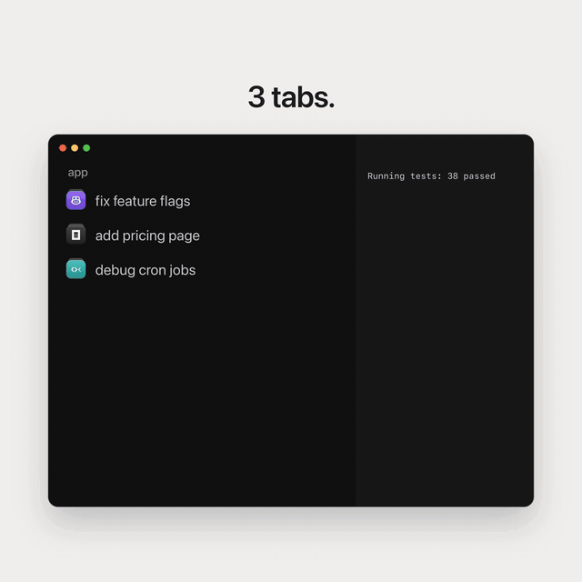

```
  █████              █████                 █████               █████
 ▒▒███              ▒▒███                 ▒▒███               ▒▒███
 ███████    ██████   ▒███████      █████  ███████    ██████   ███████   █████ ████  █████
▒▒▒███▒    ▒▒▒▒▒███  ▒███▒▒███    ███▒▒  ▒▒▒███▒    ▒▒▒▒▒███ ▒▒▒███▒   ▒▒███ ▒███  ███▒▒
  ▒███      ███████  ▒███ ▒███   ▒▒█████   ▒███      ███████   ▒███     ▒███ ▒███ ▒▒█████
  ▒███ ███ ███▒▒███  ▒███ ▒███    ▒▒▒▒███  ▒███ ███ ███▒▒███   ▒███ ███ ▒███ ▒███  ▒▒▒▒███
  ▒▒█████ ▒▒████████ ████████     ██████   ▒▒█████ ▒▒████████  ▒▒█████  ▒▒████████ ██████
   ▒▒▒▒▒   ▒▒▒▒▒▒▒▒ ▒▒▒▒▒▒▒▒     ▒▒▒▒▒▒     ▒▒▒▒▒   ▒▒▒▒▒▒▒▒    ▒▒▒▒▒    ▒▒▒▒▒▒▒▒ ▒▒▒▒▒▒
                                                      _                , __
                                                     | |              /|/  \          |
                                                     | |  __   ,_      |___/  _       |
                                                     |/  /  \_/  |     | \   |/  /\/  |
                                                     |__/\__/    |_/   |  \_/|__/ /\_/o
                                                     |\
                                                     |/
```

**Know which agent needs you. Without opening every tab!\***

<sub>\* Agents left waiting are not the responsibility of Tab Status.</sub>

Each [Rex](https://www.superlogical.com/rex) tab name starts with an emoji for what's happening in it.
I wrote this because I kept clicking through tabs to find the agent that was waiting on me.



| Emoji | Means |
|---|---|
| ⏳ | working |
| ✋ | waiting for you to approve something |
| ❓ | waiting for you to answer a question |
| 🔑 | waiting for you to log in |
| ❌ | failed |
| ✅ | finished, and you haven't looked yet |
| (none) | idle, or finished and seen |

Programs report their state to Rex through the
[program status protocol](https://www.superlogical.com/rex/docs/build/program-status) (OSC 7501).
Claude Code already does, so its tabs work with no setup. Other programs show up once they speak the protocol. When a tab has several
panes, or an agent runs work in the background, the tab shows the most urgent state.

✅ clears when you switch to the tab. Press `cmd+u` to mark a tab seen or unseen by hand,
the way you'd mark mail unread.

## Install

Tell your agent:

> Install github.com/mvwi/rex-tab-status

Or run:

```sh
curl -fsSL https://raw.githubusercontent.com/mvwi/rex-tab-status/v1/install.sh | sh
```

Options go after `sh -s --`:

```sh
curl -fsSL https://raw.githubusercontent.com/mvwi/rex-tab-status/v1/install.sh | sh -s -- --key ctrl+cmd+u
```

| Option | Does |
|---|---|
| `--key COMBO` | bind Toggle Tab Seen to COMBO instead of `cmd+u` |
| `--no-key` | bind no key; the action is still in the command palette |
| `--uninstall` | remove everything, and the emoji from tab names |

The installer refuses a key your `init.lua` already uses. It can't see the Rex app's own
shortcuts, so check the command palette before you pick an unusual one.

macOS only for now.

## What it changes

- Adds `tab-status.lua` beside your `init.lua`.
- Adds a marked block to `init.lua` that loads it and binds the key. Nothing else in the file changes.
- Adds a launchd agent, `io.github.mvwi.rex-tab-status`, that runs
  `rex do tab-status.lua --all` at login and restarts it if it stops. Rex only sends
  events to scripts run this way, not to `init.lua`.
- Keeps seen state in `~/.local/state/rex/tab-status.json` and a log in `tab-status.log` beside it.

`--uninstall` removes all of it.

## Notes

- A tab you haven't named shows its terminal's title. Setting a label hides that title, so
  for those tabs the emoji goes in front of the title, and the default label comes back
  when the state clears. Tabs you named keep your name.
- To change the emoji, edit the tables at the top of `tab-status.lua`, then run
  `rex config reload` and `launchctl kickstart -k gui/$(id -u)/io.github.mvwi.rex-tab-status`.
- "Looking at a tab" means the active tab of its session, even when the app shows a
  different session. Rex doesn't yet tell scripts which session the app shows.
- The default label pattern (`Window 0ab0edc4`) comes from current Rex builds. If a Rex
  update changes it, untitled tabs may keep a stale title.

## License

MIT
